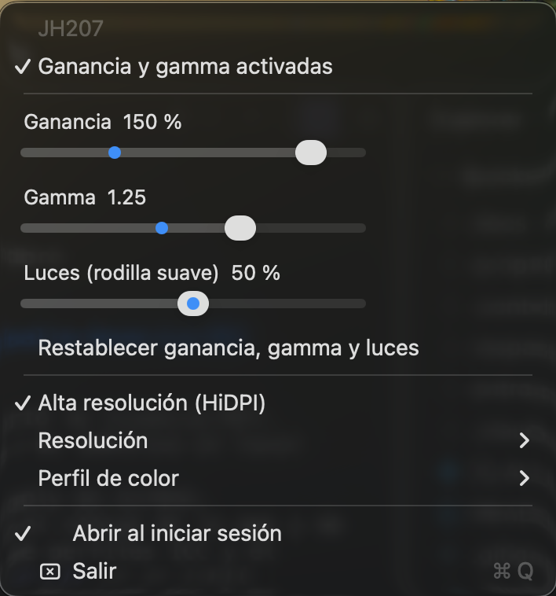

# Pantalla: más brillo percibido, perfil de color y HiDPI para monitores externos en macOS (Apple Silicon M5)

App de barra de menú para macOS pensada para **monitores externos genéricos** que se conectan a una Mac con Apple Silicon y se ven más apagados de lo que el panel puede dar. Aplica una **ganancia por software** a la tabla de color de la pantalla para **subir el brillo percibido por encima del que macOS entrega por defecto**. Está hecha solo con APIs públicas de Apple (CoreGraphics, ColorSync, ServiceManagement), sin apps de terceros:

- **Ganancia y gamma por software**, con punto azul de referencia e imán en el valor de fábrica.
- **Control «Luces» con rodilla suave**, para que la ganancia no recorte las luces.
- **Perfil de color** de la pantalla (con un filtro que oculta los perfiles que dejan la imagen oscura o que no sirven para una pantalla).
- **Resolución y HiDPI** reales en monitores que macOS no ofrece en HiDPI (sin monitor virtual), mediante un archivo de *override* del sistema.
- **Arranque automático** al iniciar sesión (SMAppService) e interruptor de encendido y apagado.

## Captura

<p align="center">
  
</p>

_Menú de la app con ganancia 150 %, gamma 1.25 y «Luces» 50 %. Los puntos azules marcan el valor de fábrica de cada deslizador._

## Qué hace y qué NO hace con el brillo

- **Sí:** multiplica los valores de cada tono (ganancia de 80 % a 160 %) y ajusta la curva (gamma y «Luces»), de modo que la imagen se ve más brillante que con el ajuste de macOS.
- **No:** no sube la retroiluminación del monitor ni supera su brillo físico máximo, y no convierte la pantalla en HDR. Es una ganancia por software.
- **Costo:** al subir la ganancia las zonas más claras no tienen adónde crecer. Con el control «Luces» (rodilla suave) se comprimen suavemente para conservar detalle; con «Luces» en 0 % se recortan a blanco.

## Compatibilidad

| | Probado | Notas |
|---|---|---|
| Mac | **MacBook Pro (Mac17,2), chip Apple M5**, 16 GB | Otras Mac con Apple Silicon deberían funcionar (mismas APIs públicas) pero **no están probadas**; Intel, tampoco |
| macOS | **26.7.1** | Requiere macOS 13 o superior por `SMAppService`; no se probó en versiones anteriores a 26.7.1 |
| Monitor | **JH207 de 1080p a 60 Hz** (un solo monitor externo a la vez) | Ganancia, gamma, «Luces», perfiles y resolución usan APIs generales y deberían servir con **cualquier monitor externo**; solo se probaron con ese monitor |
| HiDPI por *override* | Solo JH207 | Usa los ids de fabricante y producto del monitor y una lista de tamaños 16:9 para 1080p: **hay que adaptarlo a otro monitor** |
| Pantalla integrada | No se toca | La app y la CLI solo actúan sobre la primera pantalla **externa** |

La firma es *ad hoc*: se compila y corre en la misma Mac (no se puede copiar a otra sin recompilar).

## Aviso

Este software se ofrece **sin garantía**. Escribe un archivo en `/Library/Displays` (con tu contraseña de administrador, solo si lo pides desde el menú), cambia de forma permanente la resolución y el perfil de color de la pantalla, y la herramienta `pantalla-cli reconectar` usa una **API privada de macOS** que puede dejar un monitor apagado hasta reconectar el cable. Úsalo bajo tu responsabilidad.

## Contenido

| Archivo | Para qué sirve |
|---|---|
| `pantalla_jh207_barra_menu_app.swift` | La app de barra de menú |
| `pantalla_jh207_construir_app.sh` | Compila, firma (ad hoc), instala en `~/Applications/Pantalla.app` y la abre |
| `pantalla_jh207_color_hidpi_ganancia.swift` | Herramienta de línea de comandos `pantalla-cli` |
| `pantalla_jh207_generar_perfiles_icc.py` | Genera 8 perfiles ICC de pantalla en `~/Library/ColorSync/Profiles` |
| `ejemplo-override-JH207/` | El override HiDPI usado para el JH207 (ids de fabricante y producto de ese monitor) |

## Compilar e instalar

```bash
./pantalla_jh207_construir_app.sh                     # compila e instala la app y la abre
swiftc -O -swift-version 5 pantalla_jh207_color_hidpi_ganancia.swift -o pantalla-cli   # opcional: la CLI
python3 pantalla_jh207_generar_perfiles_icc.py        # opcional: 8 perfiles ICC nuevos
```

La app aparece como un icono de monitor en la barra de menú y se registra sola como ítem de inicio de sesión (se puede quitar desde el propio menú).

## El menú

- **Ganancia y gamma activadas**: interruptor general. Apagado, la pantalla vuelve a la tabla de fábrica.
- **Ganancia** (80–160 %), **Gamma** (0.6–1.6) y **Luces** (0–100 %): deslizadores con punto azul en el valor de fábrica.
- **Alta resolución (HiDPI)**: alterna entre un tamaño con y sin HiDPI. Guarda su estado.
- **Resolución**: solo tamaños 16:9 de 1280 de ancho o más, a 60 Hz, que existen en las dos versiones (base y HiDPI).
- **Perfil de color**: solo perfiles RGB que no oscurecen.
- **Abrir al iniciar sesión** y **Salir**.

## Rodilla suave y control «Luces»

Con ganancia mayor que 1, la curva clásica `min(1, entrada^(1/gamma) × ganancia)` manda todas las luces a blanco. Con ganancia 1.25 y gamma 1.15, los 58 niveles de entrada más altos (23 %) salían blancos y solo quedaban 8 niveles distintos en las luces.

La curva actual es igual hasta una rodilla `K = 1 − 0.5 × Luces`. De `K` al máximo se comprime de forma continua y monótona:

```
salida = K + r · (1 − e^(−(v−K)/s)) / (1 − e^(−D/s))      con r = 1−K, D = ganancia−K
```

`s` se resuelve por bisección para que la pendiente en `K` sea 1 y la entrada máxima llegue exactamente a 1.0. Medido con la función real, con ganancia 1.25 y gamma 1.15:

| Luces | Entradas que salen blancas | Niveles distintos en las luces (190–255) |
|---|---|---|
| 0 % (recorte duro) | 58 | 8 |
| 50 % (de fábrica) | 2 | 25 |
| 100 % | 1 | 37 |

Con ganancia 1.0 la tabla es la de fábrica sin importar «Luces».

## HiDPI sin monitor virtual

macOS solo ofrecía a este monitor HiDPI diminuto (hasta unos 2048 px de respaldo). Se logra con un archivo de *override* en `/Library/Displays/Contents/Resources/Overrides/DisplayVendorID-<hex>/DisplayProductID-<hex>`:

- **Formato que funciona (el de Apple):** cada entrada de `scale-resolutions` es `<data>` de **8 bytes** = ancho y alto de **respaldo** en enteros de 32 bits *big-endian*. `3200×1800` produce el modo `1600×900` HiDPI.
- **Formato que macOS lee pero ignora:** entradas de **16 bytes** (ancho, alto, 1, `0x00200000`) de guías antiguas: macOS aplica el nombre del monitor, pero no genera los modos, ni tras reconectar ni tras reiniciar.
- **Modos base del mismo tamaño:** entradas de **12 bytes** (ancho, alto, 1) crean el modo sin HiDPI de ese tamaño, para que el interruptor HiDPI tenga pareja.
- **Cómo se activa sin reiniciar:** reconectar el monitor por software (`pantalla-cli reconectar`) hace que macOS relea el archivo.
- **Límite encontrado:** en este monitor macOS acepta un respaldo de hasta 3712 px de ancho (1856×1044 HiDPI) y rechaza 3840 (1920×1080 HiDPI).

El menú puede instalar el override (pide la contraseña de administrador). El contenido viaja en base64 dentro del comando con privilegios, sin archivo temporal. La lista de tamaños del instalador está fija para un monitor 1080p 16:9; para otro monitor hay que adaptarla.

## Perfiles de color

- Se mide, con el motor de color de macOS (`CGColor.converted(to:)`), cuánto oscurece cada perfil un gris medio y un gris oscuro frente a sRGB, suponiendo un panel de gamma 2.2. Se ocultan los que dan menos de 0.90×, los que no son RGB y los que no se pueden evaluar. Medido: ACES CG Linear 0.15×, Generic RGB y ROMM RGB 0.70×; CMYK, Gray, L\*a\*b\* y XYZ no son RGB.
- `pantalla_jh207_generar_perfiles_icc.py` crea 8 perfiles ICC v2 (matriz y curva gamma de 1024 puntos, primarios adaptados a D50 con Bradford): sRGB gamma 2.2/2.4, Display P3 gamma 2.2/2.4, Rec. 2020, SMPTE-C, PAL EBU y ProPhoto con gamma 2.2. ColorSync no indexa al instante la carpeta de usuario, así que la app la lee directamente.

## Herramienta de línea de comandos (`pantalla-cli`)

`info`, `perfiles`, `perfil <n|texto>`, `perfil-restaurar`, `modos`, `modo <n>`, `ganancia <factor> [gamma]`, `hidpi-plist [WxH ...]`, `reconectar`. Por seguridad:

- Actúa sobre la primera pantalla **externa activa**. Si no hay, se niega; para tocar otra hay que pasar `--display <id>`.
- `reconectar` **nunca** actúa sobre la pantalla integrada. Usa `CGSConfigureDisplayEnabled`, **la única API privada del proyecto**; si el monitor no reenciende hay que reconectar el cable.
- No usar `ganancia` mientras la app esté abierta: se pelean por la misma tabla.
- El número de `modo <n>` cambia cuando cambia la lista de modos: conviene buscar el modo por texto.

## Qué instala y cómo deshacerlo

| Qué | Dónde | Cómo quitarlo |
|---|---|---|
| App | `~/Applications/Pantalla.app` | borrar la carpeta |
| Ítem de inicio | SMAppService | menú › «Abrir al iniciar sesión», o Ajustes del Sistema |
| Override | `/Library/Displays/Contents/Resources/Overrides/...` | menú › Resolución › «Quitar modos HiDPI instalados…» |
| Perfiles ICC | `~/Library/ColorSync/Profiles` | borrar los `.icc` |
| Preferencias | dominio `local.pantalla.menubar` | `defaults delete local.pantalla.menubar` |

La app no usa red ni APIs privadas, y en reposo gasta ~0 % de CPU: no hay temporizadores; reaplica la ganancia una sola vez tras un cambio de pantalla.

## Trampas conocidas

- **Pantalla negra al reconectar el monitor** (quedó a 50 Hz): cambiar a 1920×1080 a 60 Hz y reiniciar `WallpaperAerialsExtension` y `WallpaperAgent` (`killall`) la recuperó. No reiniciar `WallpaperAgent` varias veces: puede dejar invertidos los colores del texto de la barra de menú hasta reconectar.
- **Los modos de 50 Hz** de este monitor parpadearon más; por eso el menú muestra solo 60 Hz.
- **Un perfil de color lineal** (como ACES CG Linear) deja la pantalla casi negra y también las capturas de pantalla, porque se hacen con el perfil de esa pantalla.
- **Una resolución 4:3** (800×600, 640×480) en un panel 16:9 parpadeó mucho; 640×480 ni siquiera se puede aplicar.
- **`sudo` desde el prompt `!` de Claude Code** no funciona (no hay terminal); para el override se usa el cuadro de contraseña de macOS.

## Limitaciones

Firma *ad hoc* (Gatekeeper la rechaza si se copia a otra Mac); un cambio de resolución se aplica de forma permanente; el instalador de override está pensado para un monitor 1080p 16:9; probado solo en el hardware indicado arriba y con un monitor externo a la vez.

## Licencia

[MIT](LICENSE): puedes usarlo, copiarlo, modificarlo y compartirlo conservando el aviso de copyright y la licencia; se ofrece sin garantía.
